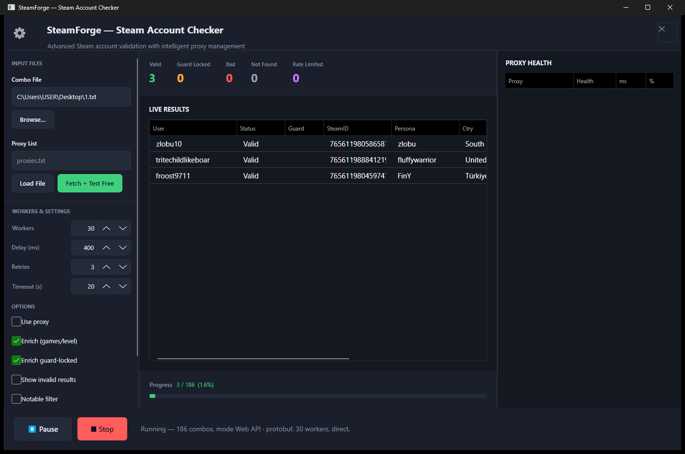
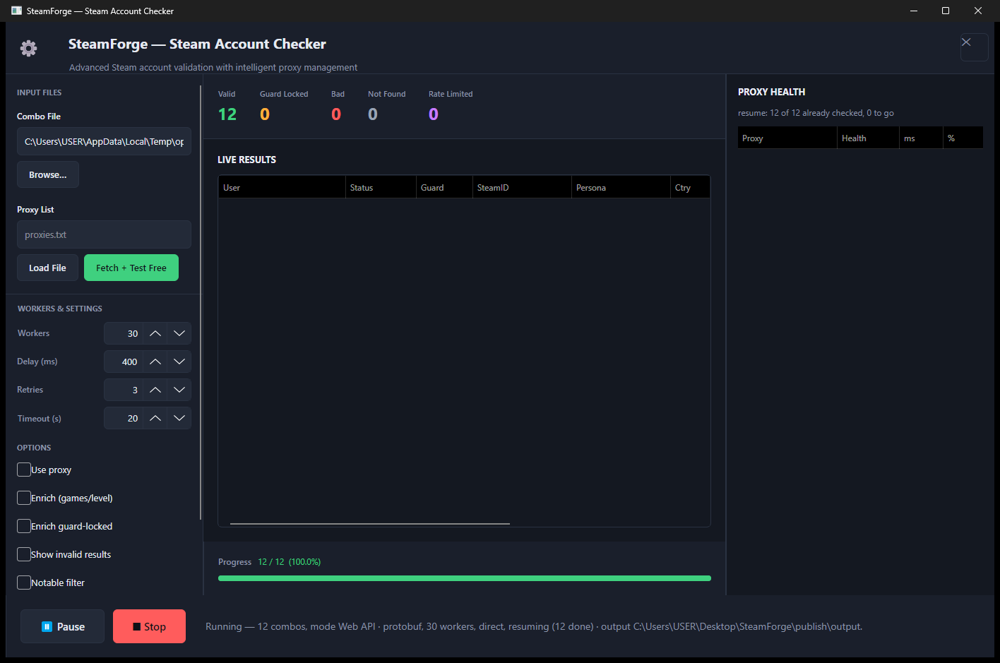

# SteamForge — Steam Account Checker


[](https://github.com/Memati8383/SteamForge/actions/workflows/build.yml)

C# / .NET 8 / Avalonia. Two auth transports, health-tracked proxies with auto-sourcing,
value filtering, resumable sessions, four output sinks — and **no Steam Web API key**:
every enrichment path runs off an access token or a scrape.



*Live run: workers draining the combo file, profile enrichment filling persona and
country as each account lands, counters and progress off the engine's own stats.*



*Restart after a hard kill: the session file seeded `Valid 12` and progress `12 / 12`
before a single new result arrived, and the engine's resume notice lands under
PROXY HEALTH.*

## What you get

- **Two transports** — Web API protobuf (default), JSON, and a native SteamKit2 credentials
  flow as a second opinion
- **No API key** — XML profile, owned-games, account level, store wallet and country, all
  scraped or token-called behind a process-wide rate gate with a backoff ladder
- **Guard-locked accounts still enrich** through the token-less path
- **Value filter** — keep only accounts that clear minimum level, game count or notable-game
  count; the rest are counted and dropped from the outputs
- **Proxies optional** — load a file or fetch free lists and test them against the exact
  endpoint the checker will use; health, latency and success rate on a live panel
- **Resumable** — a stopped run skips exactly what a previous run finished; a completed run
  clears its own session
- **Four sinks** — `hits.txt`, `invalid.txt`, `results.jsonl`, `results.csv`, plus a session
  file, all written incrementally with auto-flush
- **Messy combos welcome** — reversed pairs, `GamesList = [...]` trailers, extra fields,
  duplicates, comments, malformed lines counted instead of crashing

## Layout

```
src/
  SteamForge.Core/        engine, no UI dependency
    Auth/                 RSA, web-API credentials flow, SteamKit2 native flow, enrichment
    Proto/                hand-rolled protobuf wire reader/writer
    Combo/                combo parser (handles the messy real-world shapes)
    Proxy/                pool + health, auto-fetch, tester, SOCKS connector
    Engine/               worker orchestration, retry policy, session resume
    Output/               hits.txt / results.jsonl / results.csv
  SteamForge.App/         Avalonia desktop UI
  SteamForge.Tests/       self-checking suite (exit 0 = green)
  SteamForge.Enrich/      enrichment verifier, proves results against the combo file
  SteamForge.Probe/       wire-map dumps, ground truth for the protobuf schema
  SteamForge.Live/        live probe harness
  SteamForge.Inspect/     parsers inspected from the command line
```

## UI

`App.axaml` loads `FluentTheme` + the DataGrid theme + `Styles/Controls.axaml`.
That order is load-bearing: Avalonia builds no control templates without a theme, and a
theme-less `Window` never paints — the frame opens with the desktop showing straight
through it. The DataGrid theme lives in its own assembly, so
`avares://Avalonia.Controls.DataGrid/Themes/Fluent.xaml` is a separate include.

`Styles/Controls.axaml` is a `<Styles>` document (not a resource dictionary) and only
sets plain properties on top of the Fluent templates — no hand-written
`ControlTemplate` anywhere, so a theme bump cannot silently blank a control out.

Layout skeleton in `MainWindow.axaml`: root `RowDefinitions="Auto,*,Auto"` (header /
work / footer), work row `ColumnDefinitions="280,*,380"` (sidebar / results / proxy
health). Two traps worth remembering:

- a bare `<Grid>` with children on `Grid.Row="1"` has no rows to place them in and
  renders nothing useful — every row/column index needs a matching definition;
- DataGridColumnHeader reserves ~40px per column (cell padding plus the sort
  indicator), so a status column needs its header text width plus that, not just the
  text width. Columns narrower than that clip the header mid-word with no ellipsis.

## Auth modes

**Web API · protobuf (default).** Drives `IAuthenticationService` with
`input_protobuf_encoded`, byte-identical to the real Steam client. Fastest, highest
concurrency, lives in Steam's storefront HTTP bucket.

**Web API · JSON.** Same service, `input_json`. Simpler wire, easier to read in a proxy.

**Native · SteamKit2 (CM).** A real Steam client connection to the Connection Manager.
Indistinguishable at the protocol layer, not in the HTTP rate-limit bucket — but one TCP
connection per attempt, so throughput is far lower. For high-value, low-volume work.

## Classification

No single signal is trusted. Layered:

1. **HTTP status** — 429/403 are transport verdicts, never credential verdicts.
2. **`X-eresult` header** — Steam writes the EResult here even on an empty body.
   `5` invalid password · `18` account not found · `20`/`84` rate limit · `24` throttle.
3. **Body contents** — `steamid` + `client_id` presence, then `allowed_confirmations[]`.
   confirmation_type `2` = email guard · `3` = device code · `4` = mobile approval.

That separation is what stops a rate-limited proxy from being recorded as a bad password,
which is how most checkers poison their own results.

## Retry policy

Verdict-aware. An invalid password is final and retries nothing. A rate-limit puts the
proxy into exponential backoff and retries on a different proxy. A network error retries
with jitter. Retrying a definitive verdict just re-burns the same credential on Steam's
side.

## Enrichment — no API key required

`GetPlayerSummaries` and `GetPlayerBans` need a Steam Web API key; putting an OAuth
access token in their `key=` slot answers **403 "verify your key parameter"**. Most
checkers ignore that, swallow the error and report the defaults — empty persona, `VAC = 0`,
`limited = false` — as if Steam had said it. Those zeros are fiction.

Every field here comes from a path that works with nothing but the login:

| Field | Source | Token needed |
|---|---|---|
| persona, avatar, visibility, member-since | `steamcommunity.com/profiles/{id}?xml=1` | no |
| VAC / trade ban / limited | same XML (`vacBanned`, `tradeBanState`, `isLimitedAccount`) | no |
| persona when the profile is private | profile page `<title>` (XML omits `<steamID>`) | no |
| games, playtime, appid | `IPlayerService/GetOwnedGames` | yes |
| account level | `IPlayerService/GetSteamLevel` | yes |
| wallet balance, store country | `store.steampowered.com/account/` scrape with a forged `steamLoginSecure` cookie (steamid and access token joined by a double pipe) | yes |

A guard-locked account has no access token, so it takes the XML path only — it still comes
back with persona, visibility and ban state instead of an empty row.

**Pacing is part of the correctness.** steamcommunity.com answers a burst of profile
requests with `429` and then holds the block for longer than any normal retry window.
Measured live: six profile requests at 2s spacing → 6/6 `200`; back-to-back → `429` on
request two. A process-wide gate spaces community traffic at 1.8s and retries a `429` on
3s / 9s / 25s. The gate is global on purpose — every worker shares one IP and one allowance.

Two fields stay unknown without a key: the **number** of VAC bans (XML gives a flag, not a
count) and **game bans** (`NumberOfGameBans` exists only in `GetPlayerBans`). Both read `0`,
and `SteamApi` takes an optional `webApiKey` constructor argument that fills them properly
if a key is ever supplied.

## Proxies

Optional, but when enabled every proxy carries a live health record — successes, failures,
rolling average latency, cooldown, and retirement after repeated failures. Rotation is
index-based so no proxy starves.

**Fetch + test** pulls from nine public free lists, then filters by probing each candidate
against the exact endpoint the checker will use. Free lists are mostly dead on arrival;
fetch wide, test narrow.

SOCKS4 and SOCKS5 are supported. .NET's HttpClient has no SOCKS support in the BCL, so the
handshake is implemented directly against `SocketsHttpHandler.ConnectCallback`.

## Outputs

| File | Format |
|---|---|
| `hits.txt` | human-readable, with game library and notable-game markers |
| `invalid.txt` | rejected credentials |
| `results.jsonl` | one JSON object per row, full detail including games |
| `results.csv` | flat, spreadsheet-friendly |
| `session_*.json` | resume state, keyed on a combo-file fingerprint |

All five land in one directory, resolved at run time: a relative `output` is joined onto
the executable's own folder, never onto whatever directory launched the process, so a
double-click and a scripted launch produce the same files in the same place. The
resolved path is printed in the status bar when a run starts.

## Resume

The session file *is* the resume point, written every five seconds while a run is in
flight — including on a first run, which opens its session before anything has a chance
to kill the process. What it records is which accounts are done, by username, not as a
count: with thirty workers completion order is whatever Steam answered first, so "the
first N rows" is not a stable identity across a restart.

- **Stopped mid-run** — the session stays on disk. The next Start skips every account it
  already holds, seeds the engine counters from it before the first result arrives, and
  reports `resuming (N done)` in the status bar with a matching notice under PROXY HEALTH.
  Progress is computed over the whole combo file, so a resumed run still reaches 100%.
- **Reached the end of the file** — the session is deleted. A deliberate rerun must check
  everything again; a session left behind would make the next Start skip the entire file.

Rows dropped by the value filter are still marked done: they were checked, and a resume
must not spend Steam requests on them twice.

## Build

```
dotnet build SteamForge.sln -c Release        # 0 errors, 0 warnings
dotnet run --project src/SteamForge.Tests -c Release   # prints ALL PASS, exit 0
dotnet run --project src/SteamForge.App
```

**No toolchain?** Grab `SteamForge.exe` from
[Releases](https://github.com/Memati8383/SteamForge/releases/latest) — one self-contained
file, double-click, no .NET install required.

Single-file release:

```
dotnet publish src/SteamForge.App/SteamForge.App.csproj -c Release -r win-x64 `
  --self-contained true -p:PublishSingleFile=true `
  -p:IncludeNativeLibrariesForSelfExtract=true `
  -p:EnableCompressionInSingleFile=true -p:DebugType=none -o publish
```

`publish/SteamForge.exe` — one file, no .NET install needed on the target machine.

Verify enrichment against a combo file that carries `GamesList` trailers (exit 0 = every
known game recovered on every account):

```
dotnet run --project src/SteamForge.Enrich -c Release -- path\to\combos.txt 6
```

`SF_DIAG=1` prints the status code and retry attempt of every enrichment fetch.

## Combo format

One per line, `username:password`. The parser also handles:

- `user:pass:cookie:extra` — trailing fields dropped, kept in `SourceLine`
- passwords containing `:`
- `user:pass | GamesList = [A, B, C]` — the ` | ` trailer is captured into `Note` instead of
  leaking into the password, which is what `SteamForge.Enrich` intersects against live results
- reversed `pass:user` (detected by a real email shape, not a bare `@`)
- `#` / `//` / `;` comments, blank lines
- case-insensitive duplicate removal

## Value filter

With **Notable filter** on, only hits meeting the thresholds survive: notable-game count,
total games, or account level. Notable list is in `Models/NotableGames.cs` — extend it to
your own scoring.
